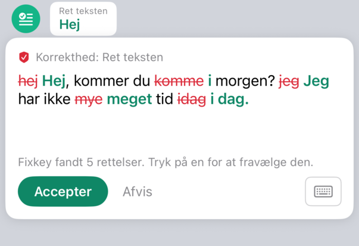
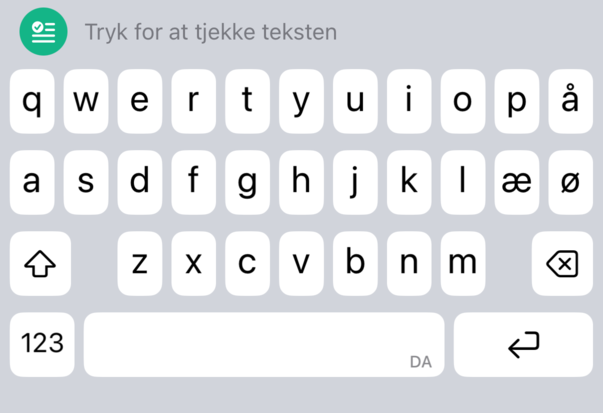
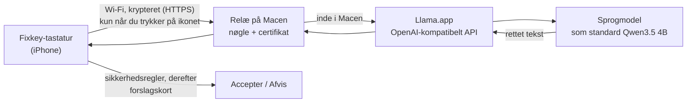

# Fixkey

[English](README.md) · **Dansk**

Fixkey er et iPhone-tastatur til dansk og engelsk, der retter stavning og grammatik med en sprogmodel, som kører på **din egen Mac**. Intet sendes til skyen: den tekst, du vælger at tjekke, går krypteret over dit hjemmenetværk til din Mac og tilbage igen og bliver aldrig gemt.

Det fungerer som Grammarlys tastatur. Skriv som du plejer, tryk på Fixkey-ikonet over tasterne, og et kort viser de foreslåede ændringer (rødt for det, der fjernes, grønt for det, der tilføjes). Tryk på en ændring, du ikke vil have, for at springe den over, og tryk så **Accepter** for at bruge resten eller **Afvis** for at beholde din tekst.

  
  &nbsp;
  

## Funktioner

- **Tjek af grammatik og stavning, når du beder om det.** Fixkey tjekker kun, når du trykker på ikonet, så det aldrig gør skrivningen langsommere eller sender tekst, du ikke har bedt om.
- **Vælg dine ændringer.** Tryk på en ændring i kortet for at beholde dine egne ord der. Accepter bruger resten.
- **Lokal model, dit valg.** Som standard Qwen3.5 4B (4-bit) i [Llama.app](https://llama.app) på Macen, testet på 53 tilfælde; et tjek tager et sekund eller to. Du kan skifte til enhver model, Llama.app kan køre, og give den point på de samme test.
- **Sæt op uden at være udvikler.** Dobbeltklik på opsætningsassistenten; den stiller et par spørgsmål og klarer resten. Bagefter starter relæet af sig selv på de Wi-Fi-netværk, du tillader, og Fixkey fornyer sig selv over Wi-Fi, før det gratis Apple-id's 7 dage er gået.
- **Krypteret og låst til din Mac.** Forbindelsen til Macen er krypteret, appen taler kun med den Mac, den blev sat op med, og relæet lytter kun på Wi-Fi-netværk, du har tilladt.
- **Sikkerhedsregler i koden.** En lille model svarer af og til på et spørgsmål, oversætter eller omskriver i stedet for at rette. Fixkey tjekker hvert svar mod regler i koden og kasserer alt, der ikke er en rettelse af din tekst. En anden regel retter modellens hyppigste danske fejl: "har" + kort tillægsform med et tidspunkt i fortiden (*har været … i går* bliver til *var … i går*).
- **Fuldt dansk tastatur.** Layoutet har æ, ø og å. Tasternes størrelse, afstande og farver er målt på Apples tastatur.
- **Hjælp til skrivningen.** Ordforslag og autokorrektur med fortryd, accenter ved langt tryk, markørstyring med mellemrumstasten, sletning af hele ord ved langt tryk på slet, punktum ved dobbelt mellemrum og dine iOS-teksterstatninger.
- **Ingen vibration.** Kun det almindelige tasteklik, som følger iPhonens indstilling for tastaturfeedback.

## Kom i gang

**[SETUP.da.md](SETUP.da.md)** tager dig igennem det hele, uden at du skal kunne programmere. Kort fortalt: installer Xcode og Llama.app, hent Fixkey, og dobbeltklik på **Fixkey Setup.command** i mappen (eller kør `./fixkey setup` i Terminal).

Opsætningsassistenten stiller et par spørgsmål, henter modellen, bygger appen, installerer den på din iPhone og tjekker, at alt virker. Hver 7. dag fornyer Fixkey sig selv over Wi-Fi; kan den ikke det, siger den til, og **Reinstall Fixkey.command** gør det over kablet. Du kan også lade en AI-assistent (Claude Code, Codex, Cursor) køre opsætningen sammen med dig; SETUP.da.md har en vejledning til den.

Spørgsmål om Xcode, det gratis Apple-id, grænsen på 7 dage, privatliv eller problemer: se **[spørgsmål og svar](docs/da/faq.md)**.

## Sådan virker det

Llama.app tager kun imod forbindelser fra selve Macen. Et lille relæ (`Tools/lan-relay`) gør det muligt for din iPhone at nå den på dit hjemmenetværk. Relæet krypterer forbindelsen med et certifikat, der laves under opsætningen, og som appen stoler på frem for alle andre, og det videresender kun de to slags forespørgsler, Fixkey bruger, og kun med den delte nøgle. Det starter af sig selv, når du logger ind, lytter kun på Wi-Fi-netværk, du har tilladt, åbner Llama.app, når et tjek har brug for den, og bruger den model, der er valgt på Macen.

## Dokumentation

| Emne | Dansk | English |
|---|---|---|
| Opsætning trin for trin | [SETUP.da.md](SETUP.da.md) | [SETUP.md](SETUP.md) |
| Spørgsmål og svar | [faq.md](docs/da/faq.md) | [faq.md](docs/en/faq.md) |
| Manuel opsætning (udviklere) | [manual-setup.md](docs/da/manual-setup.md) | [manual-setup.md](docs/en/manual-setup.md) |
| Arkitektur og kodegennemgang | [architecture.md](docs/da/architecture.md) | [architecture.md](docs/en/architecture.md) |
| Privatliv og sikkerhed | [privacy-and-security.md](docs/da/privacy-and-security.md) | [privacy-and-security.md](docs/en/privacy-and-security.md) |
| Sikkerhedsregler | [guardrails.md](docs/da/guardrails.md) | [guardrails.md](docs/en/guardrails.md) |
| Valg og test af model | [model-evaluation.md](docs/da/model-evaluation.md) | [model-evaluation.md](docs/en/model-evaluation.md) |
| Tastaturets design | [keyboard-design.md](docs/da/keyboard-design.md) | [keyboard-design.md](docs/en/keyboard-design.md) |
| Udvikling og test | [development.md](docs/da/development.md) | [development.md](docs/en/development.md) |
| Status og køreplan | [roadmap.md](docs/da/roadmap.md) | [roadmap.md](docs/en/roadmap.md) |

## Status

Fixkey 0.4 er en fungerende prototype til personligt brug. Den er testet på en iPhone og en MacBook Pro M2 med 8 GB, og den findes ikke i App Store. Telefonen når Macen på samme Wi-Fi-netværk eller over iPhonens internetdeling. Med den anbefalede model klarer den 50 af 53 testtilfælde; dem, den ikke klarer, står i [model-evaluation.md](docs/da/model-evaluation.md).

## Licens

Copyright © 2026 Mehmet Ergene. Fixkey er udgivet under [CC BY-NC 4.0](LICENSE) (Creative Commons Kreditering-IkkeKommerciel 4.0):

- **Gratis til ikke-kommercielt brug.** Du må bruge, kopiere, ændre og dele det.
- **Kreditering påkrævet.** Når du bruger, deler eller bygger videre på Fixkey, skal du kreditere udvikleren og linke til dette repository, for eksempel:
  > Bygger på [Fixkey](https://github.com/mehmetergene/fixkey) af Mehmet Ergene (CC BY-NC 4.0)

  og oplyse, om du har ændret det.
- **Intet kommercielt brug** uden skriftlig tilladelse fra udvikleren.

De fulde vilkår står i [LICENSE](LICENSE) (på engelsk).
