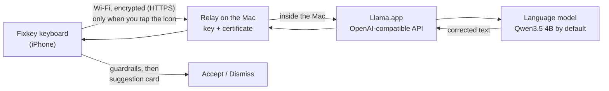

# Fixkey

**English** · [Dansk](README.da.md)

Fixkey is an iPhone keyboard for Danish and English that fixes your spelling and grammar with a language model running on **your own Mac**. Nothing goes to the cloud: the text you choose to check travels encrypted over your home Wi-Fi to your Mac and back, and is never stored.

It works like Grammarly's keyboard. Type as usual, tap the Fixkey icon above the keys, and a card shows the suggested changes (red for removed, green for added). Tap a change you don't want to leave it out, then tap **Accepter** to apply the rest or **Afvis** to keep your text.

  
  &nbsp;
  

## Features

- **Grammar and spelling checks on demand.** Fixkey only checks when you tap its icon, so it never slows down typing or sends text you didn't ask it to.
- **Choose your changes.** Tap a change in the card to keep your own words there. Accept applies the rest.
- **Local model, your choice.** By default Qwen3.5 4B (4-bit) in [Llama.app](https://llama.app) on the Mac, tested on 53 cases; a check takes a second or two. You can switch to any model Llama.app runs, and score it on the same tests.
- **Set up without a developer.** Double-click the setup assistant; it asks a few questions and does the rest. Afterwards the relay starts by itself on the Wi-Fi networks you allow, and when the free Apple ID's 7 days run out, a reminder offers a one-click reinstall.
- **Encrypted and locked to your Mac.** The connection to the Mac is encrypted, the app talks only to the Mac it was set up with, and the relay listens only on Wi-Fi networks you allowed.
- **Guardrails in code.** A small model sometimes answers a question, translates, or rewrites instead of correcting. Fixkey checks every reply against rules in code and drops anything that isn't a correction of your text.
- **Full Danish keyboard.** The layout includes æ, ø and å. Key sizes, gaps and colours were measured from Apple's keyboard.
- **Typing aids.** Word suggestions and autocorrect with undo, long-press accents, space-bar cursor control, word delete on a long backspace hold, double-space full stop and your iOS text replacements.
- **No vibration.** Only the normal key click, which follows your iPhone's Keyboard Clicks setting.

## Get started

**[SETUP.md](SETUP.md)** walks you through everything, no programming needed. In short: install Xcode and Llama.app, download Fixkey, and double-click **Fixkey Setup.command** in its folder (or run `./fixkey setup` in Terminal).

The setup assistant asks a few questions, downloads the model, builds the app, installs it on your iPhone and checks that everything works. Every 7 days, double-click **Reinstall Fixkey.command** with the iPhone connected. You can also let an AI assistant (Claude Code, Codex, Cursor) run the setup with you; SETUP.md has instructions for it.

Questions about Xcode, the free Apple ID, the 7-day limit, privacy or problems: see the **[FAQ](docs/en/faq.md)**.

## How it works

Llama.app only accepts connections from the Mac itself. A small relay (`Tools/lan-relay`) lets your iPhone reach it on your home Wi-Fi. The relay encrypts the connection with a certificate made during setup, which the app trusts and no other, and it passes on only the two requests Fixkey makes, only with the shared key. It starts by itself when you log in, listens only on Wi-Fi networks you allowed, opens Llama.app when a check needs it, and uses the model chosen on the Mac.

## Documentation

| Topic | English | Dansk |
|---|---|---|
| Setup, step by step | [SETUP.md](SETUP.md) | [SETUP.da.md](SETUP.da.md) |
| Questions and answers | [faq.md](docs/en/faq.md) | [faq.md](docs/da/faq.md) |
| Manual setup (developers) | [manual-setup.md](docs/en/manual-setup.md) | [manual-setup.md](docs/da/manual-setup.md) |
| Architecture and code tour | [architecture.md](docs/en/architecture.md) | [architecture.md](docs/da/architecture.md) |
| Privacy and security | [privacy-and-security.md](docs/en/privacy-and-security.md) | [privacy-and-security.md](docs/da/privacy-and-security.md) |
| Guardrails | [guardrails.md](docs/en/guardrails.md) | [guardrails.md](docs/da/guardrails.md) |
| Model choice and evaluation | [model-evaluation.md](docs/en/model-evaluation.md) | [model-evaluation.md](docs/da/model-evaluation.md) |
| Keyboard design | [keyboard-design.md](docs/en/keyboard-design.md) | [keyboard-design.md](docs/da/keyboard-design.md) |
| Development and tests | [development.md](docs/en/development.md) | [development.md](docs/da/development.md) |
| Status and roadmap | [roadmap.md](docs/en/roadmap.md) | [roadmap.md](docs/da/roadmap.md) |

## Status

Fixkey 0.4 is a working prototype for personal use. It is tested on an iPhone and an M2 MacBook Pro with 8 GB, and it isn't on the App Store. The phone reaches the Mac on the same Wi-Fi network, or over the iPhone's Personal Hotspot. With the recommended model it gets 45 of 53 test cases right; the misses are listed in [model-evaluation.md](docs/en/model-evaluation.md).

## License

Copyright © 2026 Mehmet Ergene. Fixkey is licensed under [CC BY-NC 4.0](LICENSE) (Creative Commons Attribution-NonCommercial 4.0):

- **Free for non-commercial use.** You may use, copy, change and share it.
- **Credit required.** When you use, share or build on Fixkey, credit the author and link to this repository, for example:
  > Based on [Fixkey](https://github.com/mehmetergene/fixkey) by Mehmet Ergene (CC BY-NC 4.0)

  and say whether you changed it.
- **No commercial use** without written permission from the author.

The full terms are in [LICENSE](LICENSE).
