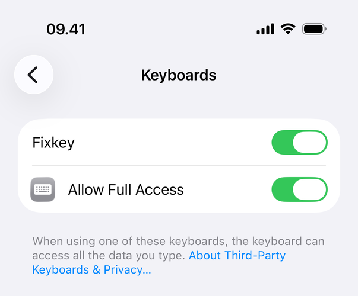
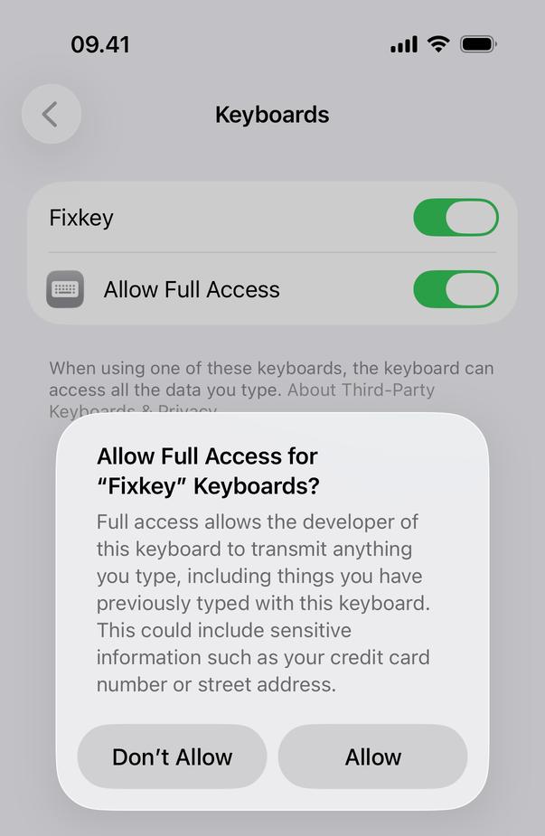
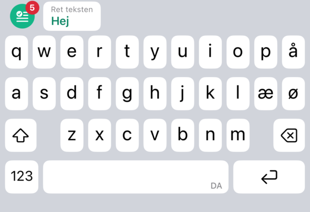
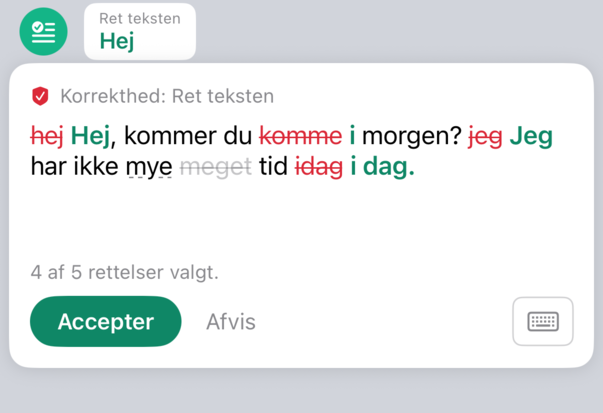
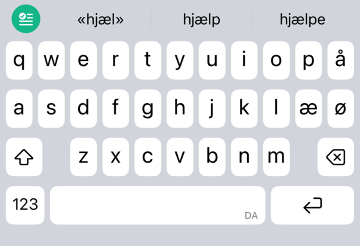

# Opsætning af Fixkey

[English](SETUP.md) · **Dansk** · [Tilbage til README](README.da.md)

Denne vejledning lægger Fixkey på din iPhone og forbinder den med en sprogmodel på din Mac. Du behøver ikke at kunne programmere, og der er ingen AI involveret: en opsætningsassistent på din Mac stiller dig et par spørgsmål og klarer arbejdet. Regn med 30 til 45 minutter, mest ventetid på hentning.

<p align="center"></p>

## Det skal du bruge

- **En Mac med Apple silicon** (M1 eller nyere) med mindst **8 GB** hukommelse og cirka **20 GB ledig** plads.
- **En iPhone med iOS 17 eller nyere** og dens **kabel**.
- **Et Apple-id.** Det gratis, du allerede har, er nok; du skal ikke betale Apple noget.
- **Wi-Fi.** Når du bruger Fixkey, skal Macen og iPhonen være på samme Wi-Fi-netværk (eller Macen på iPhonens internetdeling).

Fixkey er testet på en iPhone og en MacBook Pro M2 med 8 GB.

## To måder at sætte op på

1. **Selv, med opsætningsassistenten** (anbefales). Du dobbeltklikker på én fil; den stiller spørgsmål og klarer resten. Følg trinnene nedenfor.
2. **Med en AI-assistent**, for eksempel Claude Code, Codex eller Cursor, hvis du allerede bruger en. Åbn den i Fixkey-mappen, og skriv *"Sæt Fixkey op med SETUP.da.md"*. Den læser [afsnittet til AI-assistenter](#til-ai-assistenter) til sidst og guider dig gennem de samme trin.

## Trin 1: Installer tre ting

| Hvad | Hvorfor | Sådan |
|---|---|---|
| **Xcode** | Apples gratis værktøj, der bygger apps. Fixkey er ikke i App Store, så din Mac bygger den til din iPhone. | Installer den fra [App Store](https://apps.apple.com/app/xcode/id497799835). Åbn den én gang, klik **Agree**, og lad den installere det, den foreslår. |
| **Dit Apple-id i Xcode** | Apple lader kun apps komme på en iPhone, når de er signeret med et Apple-id. | Åbn **Xcode › Settings… › Apple Accounts** (bare **Accounts** i ældre udgaver), klik **+**, vælg **Apple ID**, og log ind. |
| **Llama.app** | Kører sprogmodellen på din Mac. | Hent den fra [llama.app](https://llama.app), flyt den til **Programmer**, og åbn den én gang. |

## Trin 2: Hent Fixkey

På [Fixkeys side på GitHub](https://github.com/mehmetergene/fixkey) klikker du på den grønne knap **Code** og derefter **Download ZIP**. Åbn den hentede fil, og flyt mappen (`fixkey-main`) til din mappe **Dokumenter**.

Bruger du git: `git clone https://github.com/mehmetergene/fixkey.git`

## Trin 3: Start opsætningsassistenten

**Dobbeltklik på `Fixkey Setup.command`** i Fixkey-mappen. Terminal åbner, og opsætningen begynder.

Første gang siger macOS måske, at den ikke kan tjekke filen, fordi det er et script fra internettet og ikke fra App Store. Så:

1. Klik **OK**.
2. Åbn **Systemindstillinger › Anonymitet & sikkerhed**, rul ned til **Sikkerhed**, og klik **Åbn alligevel** ud for *"Fixkey Setup.command" blev blokeret for at beskytte din Mac*.
3. Bekræft med din Mac-adgangskode eller Touch ID.

Derefter åbner den med et dobbeltklik.

Du kan også starte den fra Terminal: tryk ⌘ Mellemrum, skriv *Terminal*, og tryk Enter. Skriv `cd` og et mellemrum, træk Fixkey-mappen ind i vinduet, og tryk Enter. Skriv så `./fixkey setup`, og tryk Enter.

Assistenten taler dansk, hvis din Mac er sat til dansk (`./fixkey setup --lang da` vælger det). Den tjekker din Mac, Xcode og Llama.app og spørger, før den gør noget stort. Sådan ser en kørsel ud:

```text
1. Denne Mac
  ✓ Mac med Apple silicon
  ✓ 8 GB hukommelse
  ✓ 41 GB ledig plads

2. Xcode (Apples gratis værktøj, der bygger appen)
  ✓ Xcode 27.1
  ✓ Xcode er logget ind med dit Apple-id

3. Llama.app og sprogmodellen
  ✓ Llama.app kører (port 9931)
  Brug den anbefalede model, Qwen3.5 4B (testet, cirka 2,7 GB)? [J/n]
  ✗ Modellen (unsloth/Qwen3.5-4B-GGUF:Q4_K_M) er ikke hentet.
  Hent modellen nu (cirka 2,7 GB)? [J/n]
  …
  Denne Mac har 8 GB hukommelse. Hold modellens hukommelsesforbrug nede (anbefales)? [J/n]
  ✓ Modellen svarede på 6 s: “Jeg har ikke meget tid i dag.”

4. Dine indstillinger
  ✓ Signerer med team: Dit Navn (Personal Team)
  Din udgave af appen skal have sit eget id, skrevet som com.ditnavn.
  App-id (tryk Enter for forslaget) [com.ditnavn]
  ✓ App-id: com.ditnavn.fixkey
  ✓ Lavede en ny relænøgle
  ✓ Lavede relæets certifikat (krypterer Wi-Fi-forbindelsen)
  ✓ Gemte dine indstillinger i Config/Local.xcconfig (kun du kan læse den)

5. Relæet (forbinder iPhonen med denne Mac)
  Start relæet af sig selv, når du logger ind (anbefales)? [J/n]
  ✓ Tillod dette Wi-Fi-netværk for relæet
  ✓ Relæet starter nu af sig selv, når du logger ind, på de Wi-Fi-netværk, du tillader
  ✓ Relæet virker: krypteret, nøglen godkendt, Llama.app svarer

6. Din iPhone
  ✓ Fandt Din iPhone
  ✓ Udviklertilstand er slået til
  Bygger Fixkey til Din iPhone. Første gang tager det et par minutter.
  ✓ Installeret på Din iPhone
  ✓ Fixkey er åben på Din iPhone
  ✓ Din iPhone nåede denne Mac over den krypterede forbindelse
  ✓ Fixkey virker på iPhonen indtil 07.11.2026 kl. 10.00. En geninstallation inden da giver 7 dage fra det øjeblik.

7. Slå tastaturet til (én gang, på iPhonen)
  …
  ✓ Dit første tjek virkede

8. En påmindelse hver 7. dag
  Påmind dig, når det sker (anbefales)? [J/n]
  ✓ Fixkey påminder dig dagen før de 7 dage slutter, og igen når de er gået
```

Mangler der noget, siger den, hvad du skal gøre, og venter, til du har gjort det. De spørgsmål, den kan stille:

- **Brug den anbefalede model?** Svar ja, medmindre du vil prøve en anden; se [Vælg sprogmodellen](#vælg-sprogmodellen).
- **Hent modellen?** Cirka 2,7 GB, én gang.
- **Hold modellens hukommelsesforbrug nede?** Kun på Macs med 8 GB. Svar ja.
- **App-id.** Din egen udgave af appen skal have et navn som `com.ditnavn`. Tryk Enter for at bruge forslaget.
- **Start relæet af sig selv, når du logger ind?** Svar ja, så skal du aldrig starte noget igen. Det lytter kun på Wi-Fi-netværk, du tillader, begyndende med det, Macen er på nu.
- **Påmind dig, når de 7 dage slutter?** Svar ja; se [Hver 7. dag](#hver-7-dag).
- **Hvilket team eller hvilken iPhone?** Kun hvis Xcode kender flere teams, eller flere iPhones er forbundet.

## Trin 4: På iPhonen

Assistenten siger til, når du skal gøre hvert af disse trin.

**Udviklertilstand.** En iPhone kører kun apps, du selv bygger, når Udviklertilstand er slået til. Gå til **Indstillinger › Anonymitet & sikkerhed › Udviklertilstand**, slå den til, og lad iPhonen genstarte. Lås den op efter genstarten, og tryk **Slå til**. (Knappen dukker først op, når iPhonen har været forbundet med en Mac med Xcode.)

**Stol på dit Apple-id.** Første gang, og nogle gange når de 7 dage er gået, spørger iPhonen, om du stoler på udvikleren, altså dig selv. Gå til **Indstillinger › Generelt › VPN og enhedsadministration**, tryk på dit Apple-id under **Udviklerapp**, og tryk **Stol på**.

**Tillad lokalt netværk.** Første gang Fixkey-appen åbner, beder den om at finde enheder på dit lokale netværk. Tryk **Tillad**; det er sådan, den når din Mac.

**Slå tastaturet til.** Gå til **Indstillinger › Apps › Fixkey › Tastaturer**. Slå **Fixkey** til, derefter **Tillad fuld adgang**, og bekræft med **Tillad**. iOS lader kun tastaturer bruge netværket med fuld adgang; [spørgsmål og svar](docs/da/faq.md#hvorfor-skal-fixkey-have-fuld-adgang) forklarer, hvad det betyder.

<p align="center">
  
  &nbsp;
  
</p>

## Trin 5: Dit første tjek

1. Åbn **Noter** (eller en anden app, hvor du skriver), og tryk i en tekst.
2. Hold 🌐-tasten under bogstaverne nede, og vælg **Fixkey**.
3. Skriv `jeg har ikke mye tid idag`, og tryk på det runde, grønne Fixkey-ikon over tasterne.
4. Kortet viser ændringerne. Tryk på en ændring for at springe den over, og tryk så **Accepter** for at bruge resten, eller **Afvis** for at beholde din tekst.

<p align="center">
  
  &nbsp;
  
</p>

Mens du skriver, viser feltet over tasterne ordforslag ligesom Apples tastatur:

<p align="center"></p>

Opsætningsassistenten opdager dit første tjek og siger til.

## Hver dag

Starter relæet af sig selv (du svarede ja, da assistenten spurgte), er der intet at gøre. Hold Macen tændt og vågen og på Wi-Fi. Relæet starter, når du logger ind, åbner Llama.app, når et tjek har brug for den, og lytter kun på Wi-Fi-netværk, du har tilladt.

- **Et andet netværk, du bruger** (på arbejdet, hos en ven eller din iPhones internetdeling): mens Macen er på det, så dobbeltklik på **Fixkey Setup**, og vælg **Tillad dette Wi-Fi-netværk for relæet**, eller kør `./fixkey autostart add`. På et netværk, du ikke har tilladt, viser macOS en notifikation om det.
- **Uden automatisk start:** åbn Llama.app, dobbeltklik på **Fixkey Setup**, vælg **Kør relæet i dette vindue**, og hold vinduet åbent, mens du bruger Fixkey.

## Hver 7. dag

Med et gratis Apple-id holder apps, du selv bygger, op med at åbne efter 7 dage. Intet går tabt: hver geninstallation giver 7 nye dage fra det øjeblik, så du kan gøre det, når det passer dig, før eller efter de 7 dage.

1. Forbind iPhonen med kablet, og lås den op.
2. **Dobbeltklik på `Reinstall Fixkey.command`** i Fixkey-mappen. Det er det hele; det tager et minut eller to.

Påmindelsen siger til dagen før (og igen bagefter) med knappen **Geninstaller**, der gør det samme. `./fixkey doctor` viser den præcise dato. Beder iPhonen dig stole på dit Apple-id igen, så se trin 4.

## Vælg sprogmodellen

Fixkey anbefaler den model, den er testet med, **Qwen3.5 4B** (45 af 53 testtilfælde rigtige, et sekund eller to pr. tjek på en M2 med 8 GB). Du kan bruge enhver anden model, som Llama.app kan køre:

1. Dobbeltklik på **Fixkey Setup**, og vælg **Vælg sprogmodellen**, eller kør `./fixkey model`.
2. Vælg en model, du allerede har i Llama.app, eller vælg **Hent en anden model fra Hugging Face**, og skriv dens navn fra Hugging Face med kvantiseringen efter et kolon, for eksempel `unsloth/Qwen3.5-4B-GGUF:Q4_K_M`.
3. Assistenten tester den med en sætning og tilbyder at give den point på Fixkeys 53 testtilfælde ved siden af den anbefalede models 45.

Valget gemmes på Macen, og relæet bruger det, så iPhonen behøver intet. På en Mac med 8 GB skal du holde dig til cirka 4B parametre med 4-bit-kvantisering (Q4); større Macs kan prøve større modeller. [Test af modellen](docs/da/model-evaluation.md) forklarer, hvordan Fixkeys test virker.

## Hvis noget ikke virker

Dobbeltklik på **Fixkey Setup**, og vælg **Tjek alt**, eller kør `./fixkey doctor`. Den tjekker det hele (Mac, Xcode, Llama.app, modellen, dine indstillinger, relæet og iPhonen) og siger, hvad der skal rettes. [Spørgsmål og svar](docs/da/faq.md) forklarer hver besked, også dem, tastaturet viser.

Kør `./fixkey uninstall` for at fjerne det, Fixkey har sat op på Macen.

## Til AI-assistenter

Denne vejledning er til en AI-kodeassistent (Claude Code, Codex, Cursor eller lignende), som en person har bedt om at sætte Fixkey op. Personen er måske ikke udvikler. Alt nedenfor kan også gøres uden en assistent (se ovenfor); du guider kun.

**Sådan arbejder du**

- Tal enkelt. Sig før hvert trin med én sætning, hvad det gør, og hvorfor.
- Stil ét spørgsmål ad gangen, og vent på svaret. Spørg, før du henter modellen (cirka 2,7 GB), før du installerer noget, og før alt, der kræver Macens adgangskode.
- Vis, kopiér eller commit aldrig indholdet af `Tools/lan-relay/key.txt`, `Tools/lan-relay/relay-key.pem`, `Config/Local.xcconfig` eller `~/Library/Application Support/Fixkey`. Commit eller push aldrig noget.
- Kør `./fixkey`-kommandoerne med `--yes` (og gerne `--lang da`) fra repositoryets rod. Med `--yes` venter de aldrig på input: de bruger de foreslåede svar og stopper med et ✗ og et tip, når noget mangler. Kør ikke `./fixkey` uden en kommando: menuen kræver en person ved tastaturet.
- Nogle trin kan kun personen selv gøre: installere apps fra App Store eller en hjemmeside, logge ind i Xcode med sit Apple-id, tillade `Fixkey Setup.command` under Anonymitet & sikkerhed og alt på iPhonen (låse op, Stol på, Udviklertilstand, fuld adgang). Forklar de trin, vent, til personen siger, at det er gjort, og tjek så igen.

**Trin**

1. Kør `./fixkey doctor`. Den ændrer ingenting. Gå dens ✗-linjer igennem fra toppen.
2. **Xcode.** Mangler den eller er den ikke sat op, så bed personen installere den fra App Store, åbne den én gang og acceptere licensen. Peger `xcode-select` et andet sted hen, så spørg, før du kører `sudo xcode-select -s /Applications/Xcode.app`.
3. **Apple-id.** Er Xcode ikke logget ind, så bed personen åbne Xcode › Settings › Apple Accounts (Accounts i ældre Xcode) og tilføje sit Apple-id.
4. **Model.** Anbefal den testede model (Qwen3.5 4B, cirka 2,7 GB). Spørg, og kør så `./fixkey model --yes`: den starter Llama.app, henter modellen, begrænser hukommelsen på Macs med 8 GB og tester modellen. Vil personen have en anden model, så kør `./fixkey model use <ejer/model-GGUF:KVANT> --yes` i stedet, og tilbyd `./fixkey model evaluate` (et par minutter) for at sammenligne den med den anbefalede models 45/53.
5. **Indstillinger.** Foreslå et app-id-præfiks som `com.<fornavn>` med små bogstaver, og bed personen bekræfte det. Kør så `./fixkey configure --yes --prefix <præfiks>`. Kender Xcode flere teams, så spørg hvilket, og giv også `--team <ID>` med.
6. **Relæ.** Spørg, om relæet skal starte af sig selv, når personen logger ind (anbefales; det lytter kun på det nuværende Wi-Fi-netværk, til personen tillader andre). Hvis ja, så kør `./fixkey autostart on --yes`. Hvis nej, så start `./fixkey relay` som en proces, der bliver ved med at køre, i en separat terminal. Kør derefter `./fixkey test`: den skal sige, at relæet virker.
7. **iPhone.** Bed personen forbinde iPhonen med et kabel og låse den op, og kør `./fixkey install --yes`. Stopper den med et ✗, så læs tippet op, hjælp personen med det på iPhonen (Udviklertilstand, Stol på, lås op), og kør kommandoen igen.
8. **Tastatur.** Guid personen gennem Indstillinger › Apps › Fixkey › Tastaturer: slå Fixkey og Tillad fuld adgang til. Bed dem så skrive `jeg har ikke mye tid idag` i Noter med Fixkey-tastaturet og trykke på det grønne ikon. Relæets log (`~/Library/Logs/Fixkey/relay.log` med automatisk start, ellers relæets terminal) viser `POST /v1/chat/completions  200`, når tjekket når Macen.
9. **Påmindelse.** Spørg, om personen vil have en påmindelse, når de 7 dage slutter (anbefales). Hvis ja, så kør `./fixkey reminder on --yes`.
10. **Afslut.** Fortæl personen: på et andet Wi-Fi-netværk, de bruger, så kør `./fixkey autostart add` (eller brug menuen i Fixkey Setup); hver 7. dag, forbind iPhonen, og dobbeltklik på `Reinstall Fixkey.command` (hver geninstallation giver 7 nye dage); `./fixkey doctor` tjekker det hele. Henvis til `docs/da/faq.md` ved spørgsmål.
