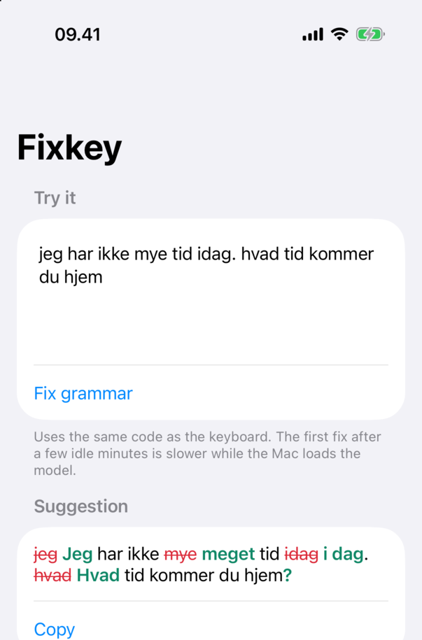

# Spørgsmål og svar

[English](../en/faq.md) · [Tilbage til README](../../README.da.md) · [Opsætning](../../SETUP.da.md)

Enkle svar om Fixkey, de apps den skal bruge, og hvad du gør, når noget ikke virker. Står dit spørgsmål ikke her, så opret en issue på GitHub.

- [Om Fixkey](#om-fixkey)
- [Det skal du bruge](#det-skal-du-bruge)
- [Det gratis Apple-id og de 7 dage](#det-gratis-apple-id-og-de-7-dage)
- [Sådan bruger du Fixkey](#sådan-bruger-du-fixkey)
- [Relæet og dit Wi-Fi](#relæet-og-dit-wi-fi)
- [Valg af sprogmodel](#valg-af-sprogmodel)
- [Privatliv og sikkerhed](#privatliv-og-sikkerhed)
- [Når noget ikke virker](#når-noget-ikke-virker)
- [Opdatering og fjernelse](#opdatering-og-fjernelse)

## Om Fixkey

### Hvad er Fixkey?

Et tastatur til din iPhone, der retter dansk og engelsk, lidt ligesom Grammarly. Forskellen er, at rettelserne kommer fra en sprogmodel, der kører på din egen Mac, ikke fra et firmas servere.

### Er den i App Store? Koster den noget?

Den er ikke i App Store. Du bygger den selv på din Mac med Apples gratis værktøjer, og det klarer opsætningsassistenten for dig. Fixkey er gratis til ikke-kommercielt brug (se [licensen](../../LICENSE)), og du skal ikke betale Apple noget.

### Hvilke sprog tjekker den?

Dansk og engelsk. Tastaturet har dansk layout med æ, ø og å, og knapperne er på dansk: **Accepter** og **Afvis**.

### Hvor gode er rettelserne?

Med den anbefalede model: gode til stavning, ordstilling, *en/et*, kommaer, store bogstaver og tid. Modellen alene beholdt nogle gange *har været*, hvor dansk skal have *var*, som i *"Vi har været i Italien sidste sommer"*; en regel i koden retter det nu. I vores test klarer den 50 af 53 tilfælde; dem, den misser, er faste udtryk som *havde travlt* og *tage fejl af* ([detaljer](model-evaluation.md)). Læs kortet, før du accepterer: en lille model kan en sjælden gang ændre betydningen.

### Virker den på iPad?

Nej, kun på iPhone.

## Det skal du bruge

### Hvilken Mac og iPhone?

- En Mac med Apple silicon (M1 eller nyere) og mindst 8 GB hukommelse.
- En iPhone med iOS 17 eller nyere.

Fixkey er testet på en iPhone og en MacBook Pro M2 med 8 GB.

### Hvad er Xcode, og hvorfor skal jeg bruge det?

Xcode er Apples gratis program til at bygge apps. Fordi Fixkey ikke er i App Store, bygger din Mac den ud fra koden og lægger den på din iPhone, og det er Xcode, der gør det. Du skal næsten ikke åbne det selv: opsætningsassistenten bruger det i baggrunden. Du åbner det én gang efter installationen og én gang for at logge ind med dit Apple-id (**Xcode › Settings… › Apple Accounts**, som hedder **Accounts** i ældre udgaver).

### Hvor meget plads fylder det?

Cirka 4 GB til Xcode (mere, hvis du lader den hente iOS-simulatoren, som Fixkey ikke skal bruge) og 2,7 GB til den anbefalede sprogmodel. Hav cirka 20 GB ledig, før du begynder.

### Hvad er Llama.app?

Et Mac-program, der kører sprogmodeller på din egen computer. Fixkey bruger det til at køre sin model: Qwen3.5 4B, medmindre du [vælger en anden](#valg-af-sprogmodel). Hent det på [llama.app](https://llama.app).

### Skal jeg bruge Terminal?

Næsten ikke. Dobbeltklik på **Fixkey Setup.command** i Fixkey-mappen, så åbner Terminal af sig selv med opsætningsassistenten. Efter opsætningen åbner den samme fil en menu med alt, hvad du skal bruge senere. Fixkey fornyer selv sine 7 dage; vil du gøre det i hånden, så dobbeltklik på **Reinstall Fixkey.command**.

Foretrækker du at skrive, er kommandoerne her. Kør dem i Fixkey-mappen: åbn Terminal (tryk ⌘ Mellemrum, og skriv *Terminal*), skriv `cd` og et mellemrum, træk mappen ind i vinduet, og tryk Enter.

| Kommando | Det gør den |
|---|---|
| `./fixkey setup` | Sætter det hele op |
| `./fixkey reinstall` | Giver 7 nye dage på iPhonen, ligesom Reinstall Fixkey.command |
| `./fixkey doctor` | Tjekker det hele og siger, hvad der skal rettes; ændrer ingenting |
| `./fixkey model` | Vælger sprogmodellen |
| `./fixkey autostart add` | Lader relæet lytte på det Wi-Fi-netværk, Macen er på nu |
| `./fixkey relay` | Kører relæet i vinduet, hvis det ikke starter af sig selv |
| `./fixkey help` | Viser alle kommandoer |

### Skal jeg være udvikler?

Nej. Kan du installere programmer på din Mac og følge en vejledning, kan du sætte Fixkey op. Du kan også lade en AI-assistent som Claude Code, Codex eller Cursor køre opsætningen sammen med dig; [SETUP.da.md](../../SETUP.da.md#til-ai-assistenter) fortæller den hvordan.

### Skal jeg bruge Homebrew, XcodeGen eller Python?

Nej. Python følger med Xcode, og alt andet er med.

## Det gratis Apple-id og de 7 dage

### Skal jeg betale for en udviklerkonto hos Apple?

Nej. Et gratis Apple-id er nok. Apple kalder det et *Personal Team*.

### Hvorfor holder Fixkey op med at åbne efter 7 dage?

Apple lader dig gratis lægge dine egne apps på din egen iPhone, men hver installation virker kun i 7 dage. Derefter åbner appen ikke, og tastaturet holder op med at virke, til den bliver geninstalleret. Det gør Fixkey selv over Wi-Fi (se nedenfor). I hånden: forbind iPhonen med Macen, lås den op, og dobbeltklik på **Reinstall Fixkey.command** i Fixkey-mappen (eller kør `./fixkey reinstall`). Det tager et minut eller to, og intet på iPhonen ændres.

Et betalt medlemskab af Apple Developer Program (cirka 99 USD om året) får en installation til at vare et år, men Fixkey har ikke brug for det.

### Kan jeg geninstallere, før de 7 dage er gået?

Ja, når som helst. Hver geninstallation giver 7 dage fra det øjeblik, så du kan gøre det før en rejse, eller når det passer dig. `./fixkey doctor` viser den præcise dato. Efter en geninstallation kan iPhonen bede dig stole på dit Apple-id igen (**Indstillinger › Generelt › VPN og enhedsadministration**).

### Fornyer Fixkey sig selv?

Ja, hvis du sagde ja under opsætningen. Når der er 2 dage tilbage, bygger Macen Fixkey igen og installerer den på iPhonen over Wi-Fi, uden kabel og uden klik, og viser en notifikation, når det er gjort. Det kræver, at Macen er vågen, og at iPhonen er på samme netværk som Macen på et tidspunkt i de 2 dage. Den prøver højst hver 3. time.

Kan den ikke det, siger Macen til dagen før slutningen med knappen **Geninstaller** til kablet. Skal Xcode have dit Apple-id igen, siger beskeden det (se [Xcode skal have mit Apple-id igen](#xcode-skal-have-mit-apple-id-igen)). Slå fornyelsen til eller fra i menuen i Fixkey Setup eller med `./fixkey reminder on` eller `off`.

### Kan jeg se på iPhonen, hvor længe Fixkey virker?

Ja: Fixkey-appen viser datoen under **Your Mac › Works until**. Du skal ikke gøre noget der; Macen fornyer den.

### Er der andre grænser med et gratis Apple-id?

To, som du sjældent møder:

- **3 apps.** Et gratis Apple-id kan højst have 3 af sine egne apps på en telefon ad gangen. Har du allerede andre, siger opsætningen til, når du skal fjerne en.
- **10 app-id'er pr. 7 dage.** Hvert nyt app-id tæller. Fixkey bruger to (appen og tastaturet), og det bruger ikke nye at geninstallere. Det gør det kun, hvis du skifter app-id.

### Hvad er Udviklertilstand?

En indstilling på iPhonen, der tillader apps, du selv bygger. Slå den til under **Indstillinger › Anonymitet & sikkerhed › Udviklertilstand**. Knappen dukker op, når iPhonen har været forbundet med en Mac med Xcode. iPhonen genstarter, og bagefter bekræfter du med **Slå til**.

### Hvorfor skal jeg "stole på" mit eget Apple-id?

iOS spørger første gang, en app fra en ny udvikler (her: dig) installeres uden om App Store. Gå til **Indstillinger › Generelt › VPN og enhedsadministration**, tryk på dit Apple-id under **Udviklerapp**, og tryk **Stol på**.

## Sådan bruger du Fixkey

### Hvad gør jeg, hver gang jeg vil bruge Fixkey?

Intet på Macen, hvis relæet starter af sig selv (opsætningen spørger og anbefaler det). Hold Macen tændt og vågen og på et Wi-Fi-netværk, du har tilladt. Skriv så på iPhonen, som du plejer, og tryk på Fixkey-ikonet, når du vil have et tjek. Relæet åbner Llama.app, når et tjek har brug for den.

Uden automatisk start: åbn Llama.app, dobbeltklik på Fixkey Setup, og vælg **Kør relæet i dette vindue** (eller kør `./fixkey relay`), og lad vinduet stå åbent, mens du bruger Fixkey.

### Skal Macen være tændt?

Ja. Modellen kører på Macen, så Macen skal være tændt, vågen og på samme Wi-Fi som iPhonen. Sover Macen, siger tastaturet, at den ikke kan finde din Mac. Har du en MacBook, så hold den åben og tilsluttet strøm, mens du bruger Fixkey.

### Kan jeg bruge Fixkey, når jeg ikke er hjemme?

Ja, med din iPhones internetdeling. Slå den til (**Indstillinger › Internetdeling**), forbind Macen til den, og tillad det netværk én gang, mens Macen er på det: dobbeltklik på Fixkey Setup, og vælg **Tillad dette Wi-Fi-netværk for relæet**, eller kør `./fixkey autostart add`. Tjek går så fra iPhonen til Macen over internetdelingens egen forbindelse, ikke over internettet.

Ellers skal Macen og iPhonen være på samme Wi-Fi-netværk. Offentlige netværk på caféer og hoteller lader ofte ikke enheder se hinanden, så brug internetdelingen der. At kunne nå Macen alle steder fra (for eksempel over Tailscale) står på [køreplanen](roadmap.md).

### Tjekker Fixkey, mens jeg skriver?

Nej. Den tjekker kun, når du trykker på det runde, grønne ikon over tasterne, så den aldrig gør skrivningen langsommere. Ordforslag og autokorrektur virker på selve iPhonen uden Macen.

### Kan jeg prøve et tjek uden tastaturet?

Ja. Åbn Fixkey-appen, skriv eller indsæt tekst under **Try it**, og tryk **Fix grammar**. Den bruger samme tjek som tastaturet, du kan trykke på ændringer for at springe dem over, og **Copy** kopierer resultatet. Længere nede viser **Your Mac**, om forbindelsen virker, og hvilken model Macen bruger.

### Hvorfor er det første tjek langsomt?

Llama.app lægger modellen væk efter 5 minutter uden brug, og det næste tjek indlæser den igen, hvilket tager et par sekunder. Var Llama.app ikke åben, åbner relæet den først, og det tager lidt længere. Derefter tager et tjek et sekund eller to.

### Kan jeg kun acceptere nogle af ændringerne?

Ja. Tryk på en ændring i kortet for at springe den over: dine egne ord bliver stående (med en prikket linje under), og forslaget bliver gråt og streget over. Tryk igen for at få den tilbage. **Accepter** bruger de ændringer, der stadig er slået til.

### Hvor meget tekst dækker et tjek?

Teksten omkring markøren, op til cirka 800 tegn på hver side, i hele sætninger. I en lang tekst sætter du markøren i den del, du vil have tjekket.

### Virker Fixkey i lys og mørk tilstand?

Ja. Den følger automatisk iPhonens udseende ligesom Apples tastatur, med de samme tastefarver i begge. Der er intet at indstille i Fixkey.

### Hvordan skifter jeg mellem Fixkey og andre tastaturer?

Hold 🌐-tasten under bogstaverne nede, og vælg et tastatur. Fixkey har ingen emoji-tast, så skift til Apples tastatur for at skrive emoji.

### Hvorfor får jeg nogle gange Apples tastatur i stedet?

iOS bruger altid sit eget tastatur til adgangskoder og nogle telefonnummerfelter, og nogle apps slår andre tastaturer fra. Det er normalt.

## Relæet og dit Wi-Fi

### Hvad er relæet?

Llama.app tager kun imod forbindelser fra selve Macen. Relæet er et lille program på Macen, der lukker din iPhone ind, og kun din iPhone: det tjekker den delte nøgle fra opsætningen, krypterer forbindelsen og videresender kun Fixkeys forespørgsler. Normalt starter det af sig selv, når du logger ind, og du ser det aldrig. Dets log, `~/Library/Logs/Fixkey/relay.log`, viser kun, hvilken slags forespørgsel der kom ind, aldrig din tekst.

### Hvilke Wi-Fi-netværk lytter relæet på?

Kun dem, du har tilladt: det netværk, Macen var på under opsætningen, og dem, du tilføjer senere. For at tilføje et skal Macen være på det; dobbeltklik så på Fixkey Setup, og vælg **Tillad dette Wi-Fi-netværk for relæet** (eller kør `./fixkey autostart add`).

På alle andre netværk lytter relæet slet ikke, så ingen der kan så meget som prøve at nå det, og macOS viser én gang en notifikation: *Relæet lytter ikke på dette Wi-Fi-netværk. Er det dit, så kør ./fixkey autostart add.* Får du en ny router, så tillad dit netværk igen.

Til det gemmer Macen ingen netværksnavne eller adresser, kun et fingeraftryk (en hash) af hvert netværks indstillinger. Vil du glemme alle netværk, så slå automatisk start fra og til igen i menuen i Fixkey Setup.

### Kan jeg slå den automatiske start fra?

Ja: vælg **Stop med at starte relæet af sig selv** i menuen i Fixkey Setup, eller kør `./fixkey autostart off`. Kør så relæet i et vindue, når du vil bruge Fixkey. Slå automatisk start til igen i samme menu eller med `./fixkey autostart on`.

### macOS siger, at der er tilføjet emner, der kan køre i baggrunden

Det er Fixkeys relæ og fornyelsen, som nu starter, når du logger ind. macOS viser dem under **Systemindstillinger › Generelt › Loginemner & udvidelser**. Lad dem være tilladt; `./fixkey uninstall` fjerner begge.

### macOS spørger, om Python må tage imod indgående forbindelser

Klik **Tillad**. Det er relæet, som skal kunne modtage iPhonens forespørgsler.

## Valg af sprogmodel

### Hvilken model bruger Fixkey?

Som standard Qwen3.5 4B (`unsloth/Qwen3.5-4B-GGUF:Q4_K_M`), den model Fixkey er testet med: 50 af 53 testtilfælde rigtige, et sekund eller to pr. tjek på en M2 med 8 GB og cirka 2,7 GB på disken. Opsætningen anbefaler den.

### Kan jeg bruge en anden model?

Ja. Dobbeltklik på Fixkey Setup, og vælg **Vælg sprogmodellen**, eller kør `./fixkey model`. Vælg en model, du allerede har i Llama.app, eller hent en anden fra Hugging Face ved at skrive dens navn med kvantiseringen efter et kolon, for eksempel `unsloth/Qwen3.5-4B-GGUF:Q4_K_M`. Assistenten henter den og tester den med en sætning.

Derefter bruger relæet den til hvert tjek. iPhonen behøver intet: Fixkey-appen viser modellen under **Your Mac**. Vil du tilbage, så vælg den anbefalede model i samme menu; den står altid først på listen.

### Hvordan ved jeg, om en anden model er god?

Giv den point: `./fixkey model evaluate` kører Fixkeys 53 testtilfælde på den nuværende model på et par minutter og sammenligner resultatet med den anbefalede models 50 (`./fixkey model evaluate <navn>` giver en anden model point). Se især på *unchanged* og *safety*: en god model lader korrekt tekst være og følger aldrig instruktioner, der står i din tekst. [model-evaluation.md](model-evaluation.md) forklarer testene.

### Hvilke modeller passer til min Mac?

På 8 GB skal du holde dig til cirka 4 milliarder parametre (4B) med 4-bit-kvantisering (Q4_K_M); større modeller gør Macen langsom. Med 16 GB eller mere kan du prøve modeller på 7B til 9B. Fixkeys [sikkerhedsregler](guardrails.md) gælder for alle modeller: et svar, der ikke er en ren rettelse, bliver kasseret.

## Privatliv og sikkerhed

### Hvor bliver min tekst af?

Den går kun til din Mac, og kun når du trykker på Fixkey-ikonet. Ikke til skyen, ikke til os og ikke til nogen andre. Intet bliver gemt: hverken af tastaturet, relæet eller Llama.app. Relæets log viser kun, hvilken slags forespørgsel der kom ind, aldrig teksten.

### Hvorfor skal Fixkey have fuld adgang?

iOS giver ikke tastaturer adgang til netværket, medmindre du slår **Tillad fuld adgang** til, og Fixkey skal bruge netværket for at nå din Mac. iOS advarer så om, at tastaturet *kunne* sende det, du skriver. Fixkey sender kun tekst, når du trykker på ikonet, og kun til din Mac. Koden er offentlig, så alle kan tjekke det.

### Er forbindelsen sikker?

Ja. Forbindelsen er krypteret (HTTPS), og appen stoler kun på det certifikat, din Mac lavede under opsætningen, så en anden enhed ikke kan udgive sig for at være din Mac. Relæet kræver også den delte nøgle, der er bygget ind i din udgave af appen, og det lytter kun på Wi-Fi-netværk, du har tilladt. Mere i [privatliv og sikkerhed](privacy-and-security.md).

### Hvad gemmer Fixkey på min Mac?

Dine indstillinger i `Config/Local.xcconfig` og relæets nøgle og certifikat i `Tools/lan-relay`, som kun din bruger kan læse. Til relæet, der starter af sig selv, og til fornyelsen ligger kopier af det, de skal bruge (cirka 2 MB, med dine indstillinger og din nøgle), i `~/Library/Application Support/Fixkey`. Fornyelsens builds ligger i `~/Library/Caches/Fixkey` (cirka 130 MB) og logs i `~/Library/Logs/Fixkey`. Aldrig tekst.

### Kan Fixkey se mine adgangskoder?

Nej. iOS skifter altid til sit eget tastatur i felter til adgangskoder.

## Når noget ikke virker

Begynd på Macen: dobbeltklik på Fixkey Setup, og vælg **Tjek alt**, eller kør `./fixkey doctor`. Den tjekker det hele og siger, hvad der skal rettes.

### macOS vil ikke åbne Fixkey Setup.command

macOS blokerer scripts fra internettet første gang, fordi de ikke kommer fra App Store eller en registreret udvikler. Klik **OK**, åbn **Systemindstillinger › Anonymitet & sikkerhed**, rul ned til **Sikkerhed**, klik **Åbn alligevel** ud for *"Fixkey Setup.command" blev blokeret for at beskytte din Mac*, og bekræft med din adgangskode eller Touch ID. Derefter åbner den med et dobbeltklik, og det gør Reinstall Fixkey.command også, for opsætningen tillader den med.

Filen er almindelig tekst: åbn den med TextEdit for at se, at den kun starter `./fixkey` i samme mappe.

### Tastaturet viser en besked. Hvad betyder den?

| Besked på tastaturet | Betydning | Det gør du |
|---|---|---|
| *Slå »Tillad fuld adgang« til i Indstillinger* | Fuld adgang er slået fra | **Indstillinger › Apps › Fixkey › Tastaturer › Tillad fuld adgang** |
| *iPhonen er ikke på Wi-Fi* | iPhonen har intet netværk | Forbind iPhonen til Wi-Fi |
| *Kan ikke finde din Mac – er den tændt og på samme Wi-Fi?* | Macen er slukket, sover eller er på et andet netværk | Væk Macen; brug samme Wi-Fi på begge; slå VPN fra |
| *Relæet lytter ikke – kør ./fixkey doctor på din Mac* | Macen er der, men relæet lytter ikke: det kører ikke, eller Macen er på et Wi-Fi-netværk, du ikke har tilladt | Kør `./fixkey doctor`; på et netværk, der er dit, `./fixkey autostart add` |
| *Llama.app kører ikke – åbn den på din Mac* | Relæet kører, men Llama.app gør ikke | Åbn Llama.app |
| *Forkert nøgle – kør ./fixkey reinstall på din Mac* | Appen og relæet har forskellige nøgler | Kør `./fixkey reinstall` |
| *Relæet passer ikke til appen – kør ./fixkey doctor på din Mac* | Relæets certifikat er ikke det, appen kender | Kør `./fixkey doctor`, og som regel `./fixkey reinstall` |
| *Kan ikke nå din Mac* | Et andet netværksproblem | Kør `./fixkey doctor` |
| *Det tog for lang tid – prøv igen* | Modellen var for længe om det | Prøv igen; det første tjek efter en pause er langsommere |
| *Fejl fra serveren* | Llama.app svarede med en fejl, for eksempel fordi den valgte model ikke er hentet | Kør `./fixkey doctor`, eller vælg modellen igen med `./fixkey model` |
| *Intet svar fra modellen* | Modellen svarede med ingenting | Prøv igen |
| *Ingen sikker rettelse* | Modellens svar var ikke en ren rettelse (for eksempel et svar eller en oversættelse), så det blev kasseret | Din tekst er uændret. Omformulér, eller tjek en kortere del. |
| *Teksten er for lang til ét tjek* | Svaret blev afbrudt | Sæt markøren i en kortere del, og tjek igen |
| *Teksten er ændret – tjek igen* | Du ændrede teksten, mens kortet var åbent | Tryk på ikonet igen |
| *Fjern markeringen først* | Der er markeret tekst | Tryk én gang for at fjerne markeringen |
| *Skriv noget først* | Der er ingen tekst at tjekke | Skriv noget |

### Fixkey-appen siger "Mac not found", "Relay not listening" eller lignende

Afsnittet **Your Mac** i appen tjekker hele forbindelsen og viser et tip under **Status**. Løsningerne er de samme som i tabellen ovenfor. **Check again** tester igen.

### Fixkey vil ikke åbne på iPhonen

De 7 dage er nok gået, og Macen kunne ikke forny Fixkey i tide. Forbind iPhonen, og dobbeltklik på **Reinstall Fixkey.command** (eller kør `./fixkey reinstall`). Siger iPhonen derefter, at udvikleren ikke er godkendt, så stol på dit Apple-id under **Indstillinger › Generelt › VPN og enhedsadministration**.

### Opsætningen eller geninstallationen stopper med en fejl

Assistenten forklarer de almindelige:

- **Xcode er ikke logget ind, eller login er udløbet:** **Xcode › Settings… › Apple Accounts**, log ind igen.
- **iPhonen er låst:** lås den op, og kør kommandoen igen.
- **Udviklertilstand er slået fra:** se [Hvad er Udviklertilstand?](#hvad-er-udviklertilstand)
- **App-id'et er optaget:** vælg et andet med `./fixkey configure --prefix com.ditnavn.noget`, og kør `./fixkey reinstall`.
- **Grænsen på 3 apps:** slet en anden af dine egne apps fra iPhonen (hold på ikonet, og vælg **Fjern app**).

Hele loggen ligger i mappen `build`.

### Xcode skal have mit Apple-id igen

Apple beder af og til Xcode om at logge ind igen, og indtil da kan ingen app fornyes. Fixkey siger det: *"Xcodes login med dit Apple-id er udløbet eller mangler"* eller en besked fra fornyelsen. Åbn Xcode, vælg **Xcode › Settings… › Apple Accounts**, vælg dit Apple-id, og log ind. Fixkey fornyer sig selv ved næste forsøg, eller dobbeltklik på **Reinstall Fixkey.command**.

### Macen bliver langsom, mens Fixkey kører

På en Mac med 8 GB skal kun én model være indlæst. Afslut og åbn Llama.app igen, og luk andre store programmer. Opsætningsassistenten tilbyder også en hukommelsesgrænse til Macs med 8 GB.

## Opdatering og fjernelse

### Hvordan opdaterer jeg Fixkey?

Hent den nye udgave ligesom første gang, og dobbeltklik på Fixkey Setup i den nye mappe. Den finder indstillingerne fra din tidligere mappe og tilbyder at bruge dem, så iPhonen beholder den samme app; derefter geninstallerer den appen. Bagefter kan du slette den gamle mappe.

Med git: kør `git pull` i mappen og derefter `./fixkey setup`.

### Hvordan fjerner jeg Fixkey?

1. På iPhonen holder du på Fixkey-appen og vælger **Fjern app**. Tastaturet forsvinder med den.
2. På Macen kører du `./fixkey uninstall` i Fixkey-mappen. Den fjerner relæet, der starter af sig selv, fornyelsen og deres filer, builds og logs.
3. Slet Fixkey-mappen.
4. Hvis du vil, kan du slette modellen i Llama.app og fjerne Fixkeys afsnit fra `~/.config/llama/models.user.ini`.
